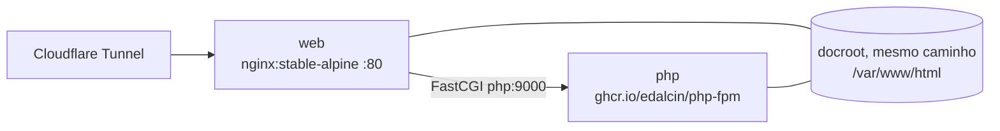

# php-fpm

Imagem PHP-FPM comum ao EC2 (produção) e ao UNRAID (dev/homologação):
`ghcr.io/edalcin/php-fpm`. Base `php:8.5-fpm-alpine` oficial + `gd`, `mysqli`,
`pdo_mysql`, `intl`, `bcmath`, `exif` e `php.ini-production`.

Substitui `tangramor/nginx-php8-fpm` (abandonada em PHP 8.5.7, vulnerável a
PHP2Shell — CVE-2026-109618/109619).



Os dois containers ficam na mesma rede docker definida pelo usuário. O nginx
resolve `php` pelo nome do container. No `nginx-site.conf`:

```nginx
fastcgi_pass php:9000;
```

## Atualização

O Dependabot abre PR quando sai um novo digest de `php:8.5-fpm-alpine`. O merge
em `main` publica `latest` e `sha-<commit>`. Depois, atualize o container `php`
em cada host (UNRAID: **Docker → php → Force update**; EC2: trocar o digest no
`docker-compose.yml` e `docker-compose up -d php`).

## Instalação no UNRAID (Docker → Add Container)

Pré-requisitos (uma vez):

1. **Settings → Docker** (com o Docker parado): *Preserve user defined networks* = **Yes**.
2. No terminal: `docker network create web-php`.

Container **php**:

| Campo | Valor |
|---|---|
| Name | `php` |
| Repository | `ghcr.io/edalcin/php-fpm:latest` |
| Network Type | `Custom: web-php` |
| Extra Parameters | `--user 101:101` (dono dos dados que os sites gravam: `.dados/`, uploads, SQLite) |
| Path `/var/www/html` | pasta do docroot (`rw`: os sites gravam dentro dela) |
| Variable `TZ` | `America/Sao_Paulo` |

Sem porta publicada: só o nginx fala com o FPM.

Container **web**:

| Campo | Valor |
|---|---|
| Name | `web` |
| Repository | `nginx:stable-alpine` |
| Network Type | `Custom: web-php` |
| Port 80 | porta do host (ex.: `8787`) |
| Path `/var/www/html` | o mesmo docroot (`ro`) |
| Path `/etc/nginx/conf.d/default.conf` | arquivo `nginx-site.conf` (`ro`) |
| Variable `TZ` | `America/Sao_Paulo` |

## EC2 (docker-compose)

```yaml
  php:
    image: ghcr.io/edalcin/php-fpm@sha256:<digest>  # tag de origem: latest
    container_name: php
    user: "101:1000"
    volumes:
      - /home/ec2-user/web:/var/www/html:ro
    networks: [cloudflare]
```
